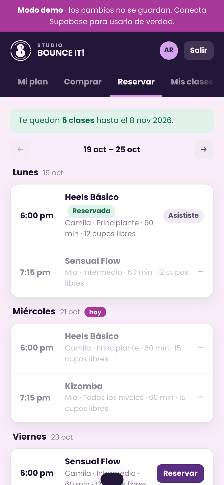
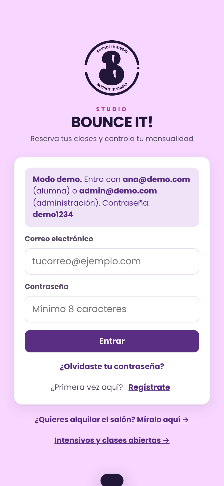
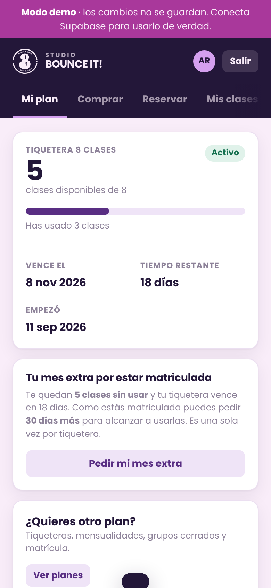
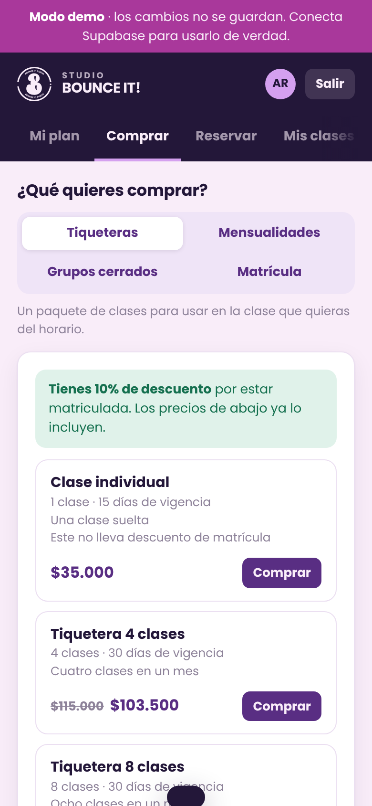
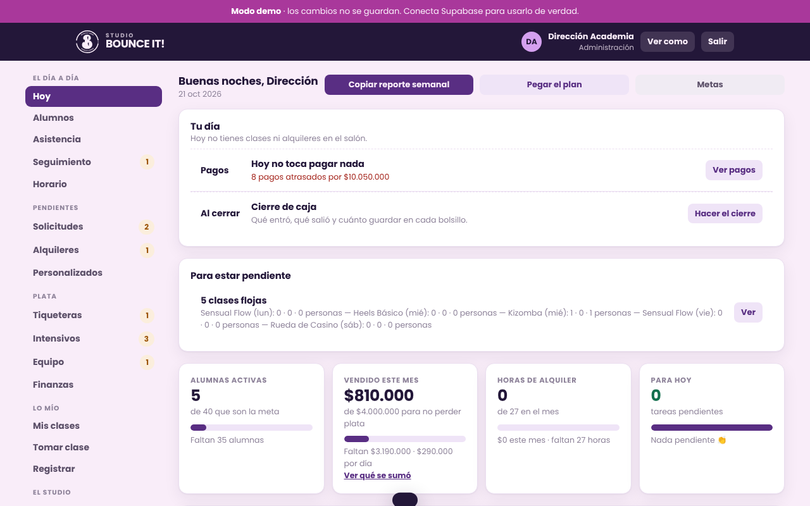
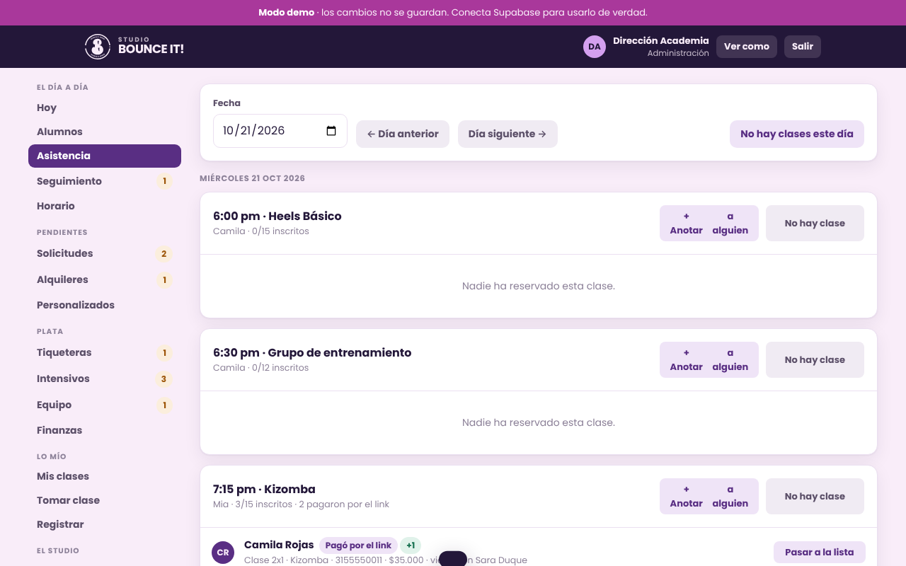
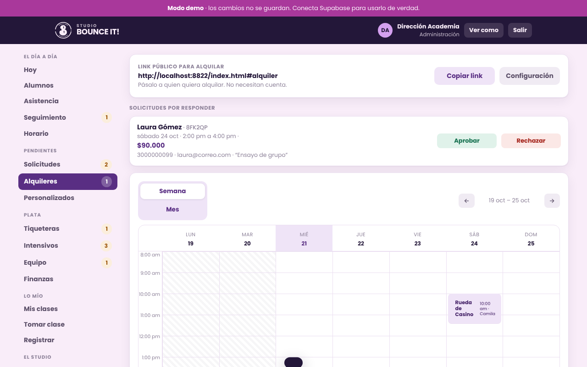
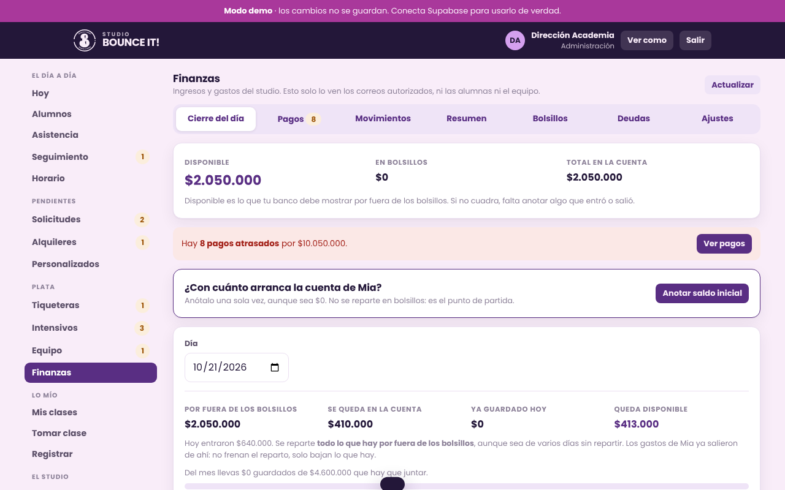

# Bounce It! Studio · App de reservas y gestión

App web para un estudio de baile en Colombia: las alumnas reservan y pagan sus clases, las profes ven su agenda y registran lo que dictan, y la administración lleva asistencia, alquiler del salón, estadísticas y finanzas desde un solo lugar.

> Esta es una **versión de portafolio**. Todos los nombres, teléfonos, correos, montos y datos bancarios son **de ejemplo**. La app abre en **modo demo**, con datos inventados que viven en el navegador, así que la puedes probar sin crear ninguna cuenta.



---

## El problema

El estudio funcionaba con WhatsApp, cuadernos y hojas de cálculo:

- Las alumnas escribían para reservar, cancelar o preguntar cuántas clases les quedaban, y alguien tenía que contestar a mano.
- Las reposiciones y las clases tomadas se anotaban en papel, y se perdían.
- Para pagarle a las profes había que contar la asistencia de cada clase.
- Nadie sabía con certeza cuánta plata entraba, cuánto había que guardar para el arriendo o qué clases se estaban quedando vacías.

## Lo que hace

**Para las alumnas** (pensado para el celular):
- Ver el horario de la semana y reservar o cancelar, con la regla de cancelación aplicada sola.
- Comprar tiqueteras, mensualidades, grupos cerrados o la matrícula. Pueden pagar por transferencia (mandan el comprobante desde la app) o en efectivo en el estudio.
- Ver cuántas clases les quedan y hasta cuándo, pedir el mes extra, congelar el plan y reponer clases.
- Inscribirse a intensivos y alquilar el salón.
- Leer los términos y condiciones, con un resumen de lo importante la primera vez que entran.

**Para las profes:**
- Su agenda con quién reservó cada clase.
- Registrar las clases que dictaron. El valor sale de la asistencia y no se puede inflar.
- Su cuenta: lo que se les debe, descuentos y pagos.

**Para la administración:**
- Panel "Hoy": tareas del día, alumnas por renovar, clases con poca gente y un reporte semanal listo para copiar.
- Asistencia, seguimiento de primeras clases (conversión) y alumnas en riesgo de no renovar.
- Calendario del salón con alquileres, bloqueos y solicitudes por aprobar.
- Estadísticas: ingresos por clase, punto de equilibrio, ocupación y renovaciones.
- Finanzas: ingresos y gastos, "bolsillos" para separar la plata de cada pago fijo, deudas y un cierre del día que dice cuánto guardar en cada bolsillo.

## Cómo funciona

- **Un solo archivo `index.html`** con HTML, CSS y JavaScript sin frameworks. Toda la app (unas 19.600 líneas) se publica arrastrando la carpeta a Netlify.
- **Supabase** (Postgres) es la base de datos y el inicio de sesión. Las reglas importantes viven en la base, no en el navegador:
  - **Row Level Security**: cada alumna solo ve lo suyo.
  - **Más de 200 funciones RPC** (`security definer`) para reservar, cobrar, repartir la plata o armar reportes.
  - El precio y los descuentos los calcula el servidor; el navegador nunca envía el monto.
- **Modo demo**: si no hay claves de Supabase, la app usa una capa de datos en memoria con la misma interfaz que la real. Eso permite probarla completa sin servidor y probar las pantallas con Playwright.
- **PWA**: se puede instalar en el celular como si fuera una app (`manifest.json` y sus íconos).

## Tecnologías

| Parte | Qué se usó |
|---|---|
| Interfaz | HTML, CSS y JavaScript sin frameworks; un solo archivo |
| Base de datos y login | Supabase (PostgreSQL, Auth, Row Level Security, funciones PL/pgSQL) |
| Cliente | `@supabase/supabase-js` cargado desde CDN |
| Exportar a Excel | SheetJS (`xlsx`) desde CDN |
| Publicación | Netlify (sitio estático) |
| Pruebas | Playwright, con recorridos de navegador en modo demo (se usaron durante el desarrollo y no vienen en este repositorio) |

## Cómo correrlo

### 1. Modo demo (lo más rápido)

Necesitas servir la carpeta por http, porque el navegador no carga módulos abriendo el archivo con doble clic:

```bash
# con Python
python3 -m http.server 8000
# o con Node
npx serve .
```

Abre `http://localhost:8000`. Puedes entrar como:

| Rol | Correo | Contraseña |
|---|---|---|
| Administración | `admin@demo.com` | `demo1234` |
| Alumna | `ana@demo.com` | `demo1234` |
| Profe | `profe@demo.com` | `demo1234` |

En el navegador, la consola puede mostrar un aviso porque no existe `config.js`. Es normal: así arranca en modo demo.

### 2. Conectado a tu propio Supabase

1. Copia `.env.example` como `.env` y pon la URL y la clave **pública (anon)** de tu proyecto.
2. Genera la configuración:
   ```bash
   node scripts/generar-config.mjs
   ```
   Eso crea `config.js`, que está en `.gitignore`: tus claves no se suben al repositorio.
3. Sirve la carpeta igual que en el paso anterior, o súbela a Netlify **con** `config.js` adentro.

> El esquema de la base de datos (tablas, políticas y funciones) **no está incluido** en esta versión de portafolio, porque las migraciones originales tenían datos reales del estudio. Para usarla con tu propio Supabase necesitarías recrear ese esquema.

## Estructura

```
.
├── index.html               # toda la app
├── guia.html                # guía para alumnas
├── guia-profes.html         # guía para profes
├── manifest.json, iconos    # para instalarla como app
├── scripts/
│   └── generar-config.mjs   # .env → config.js
├── docs/capturas/           # capturas en modo demo
├── .env.example
└── .gitignore
```

## Capturas

| | |
|---|---|
|  |  |
|  |  |







## Seguridad y privacidad

- Ninguna clave va en el código. La clave `service_role` de Supabase nunca debe estar en el navegador, y el script se niega a usarla.
- El resumen para compartir fuera de la app ("Copiar todo") no lleva nombres ni teléfonos de las alumnas.
- Los datos de esta versión son inventados: nombres, teléfonos, cuentas bancarias, NIT y montos.
